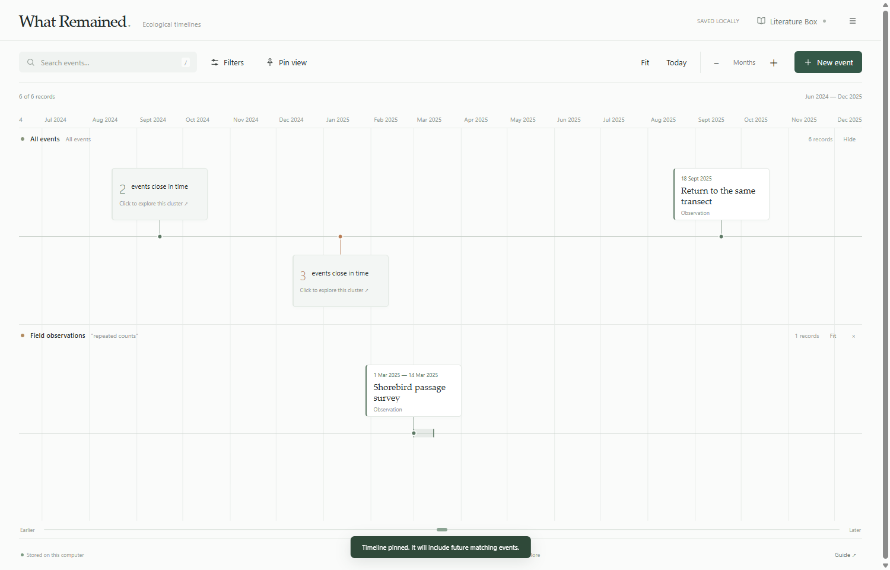

# What Remained

A private ecological notebook across time. A modern, minimalist Windows desktop app with Palatino headings and event content, with local SQLite storage and a read-only connection to Literature Box.

## Download for Windows

[Download the installer](https://github.com/Vandi-LiangWaner/what-remained/releases/download/v1.1.0/What-Remained-1.1.0-Setup.exe) or [download the portable ZIP](https://github.com/Vandi-LiangWaner/what-remained/releases/download/v1.1.0/What-Remained-1.1.0-portable.zip). All builds and checksums are on the [releases page](https://github.com/Vandi-LiangWaner/what-remained/releases).

Run the installer to create Start menu and desktop shortcuts, or extract the portable ZIP and open `What Remained.exe`. The installer does not require administrator rights. This initial release is unsigned.



Your notebook lives in **Documents/Reminiscence**, independently of the application folder. The SQLite database is `reminiscence.sqlite`; managed files live in `Attachments`. An automatic database backup is refreshed after edits in `Backups`. Use **Notebook settings → Export portable backup** to include attachments in a portable JSON backup. Import merges event IDs and updates matching records. To remove the application, right-click `Uninstall.ps1` in its installation folder and run it with PowerShell; notebook data is retained.

The app was previously named Reminiscence. Its existing notebook directory, database filenames, and backup format identifier are deliberately retained so the rename opens the same data and remains compatible with older backups. The visible app name, executable, installer, and shortcuts are now What Remained.

The timeline occupies the page itself, with a compact toolbar and one shared date ruler. Pinned filters become aligned rows on the same unboxed canvas, with continuous time guides and one shared travel slider. Controls use Segoe UI; headings, event content, and long notes retain Palatino Linotype.

Travel defaults to Fast (4× wheel distance), accelerates larger gestures, and adds a 3× boost while holding Shift. Choose Gentle, Standard, Fast, or Very fast in notebook settings. Shift + arrow keys also travels farther.

## Your landscape

- Add point events or periods. Dates accept `YYYY`, `YYYY-MM`, and `YYYY-MM-DD`; partial dates retain their precision. Dates are interpreted in UTC to prevent timezone drift. Period endpoints use the entered date (a year-only endpoint anchors to January 1).
- Add descriptions, notes, places, species, tags, arbitrary named fields, captioned images, PDFs, and other attachments. Attached files are copied into managed local storage (100 MB per file). Images can be enlarged and traversed with the arrow keys. Reorder attachments with ↑.
- Create categories and choose their colors. Each event can also use its own connector color. Updating a category palette updates events assigned to that category.
- Scroll to travel, drag to pan, or use the bottom travel slider. Ctrl + scroll and the zoom controls zoom smoothly. Arrow keys pan a focused timeline; + / − zoom. **Fit** frames matching events. Double-click empty space to add an event at that date.
- Hover a period to see an enlarged period lens; open it and choose **Fit period** to inspect its interval in the timeline.
- Search across event fields, custom fields, filenames, captions, category names, and all synced paper metadata. Search ignores case and accents. Multiple words use AND; selected categories use OR. Other filters use AND; date filters include overlapping periods.
- Pin any filter under a name to create an additional timeline. Pins retain their own filters and automatically include future matching events. All timelines share one zoom and time position. Hide the search lane when comparing pins.
- Dense views group events into clickable clusters. Click to browse every member or zoom closer. Only visible clusters are drawn; records are never dropped to reduce rendering load.
- Changes save in the background after a brief pause and are flushed before normal app closure. Invalid drafts remain open with an error. An empty new event is discarded on close.

## Literature Box

The app looks for **Documents/Literature Box Library/literature-box.sqlite**, matching the current LitBox configuration in this workspace. Choose another SQLite library from the Literature Box panel if needed. Classic and Stacks currently point to that same library; you can select a different library explicitly.

While open, What Remained checks the source every 20 seconds, reads it in SQLite read-only mode, and updates its own paper copies when the source revision changes. It never writes to Literature Box. Papers appear at publication dates; a year-only date remains year-level. Invalid or missing publication dates go into the undated list. Source fields are read-only here; add your own notes, custom fields, attachments, and category/color assignments separately. Paper figures are copied to local managed files. Papers removed from the source are retained with a source-unavailable label. Hiding a paper only hides its timeline copy, and hidden papers can be restored in settings. Only one source library is connected at a time; switching libraries treats matching LitBox card IDs as the same paper.

Sync happens only while this app is open. Standalone source synchronization uses the `app_state.cards_json` and `revision` format of this LitBox version.

## Development

The renderer uses plain HTML/CSS/JavaScript. Electron 36.9.5 supplies the isolated window; a worker thread owns SQLite and all database operations. No npm dependencies, cloud APIs, analytics, or internet connection are needed to run the app. External source links open only when clicked.

Run tests with Node 24:

```powershell
node --test tests/core.test.cjs tests/store.test.cjs
```

Place the official Windows x64 Electron 36.9.5 archive in a local cache, then build:

```powershell
powershell -ExecutionPolicy Bypass -File scripts/build.ps1 -ElectronZip C:\path\electron-v36.9.5-win32-x64.zip
```

The build uses the Windows .NET Framework C# compiler for a simple per-user installer and creates a portable ZIP. Its source is `scripts/Installer.cs`. No runtime is checked into Git.

The automated Electron smoke test uses a separate notebook and example records. It exercises actual saving, search, pin persistence, the period lens, and a 12,000-event renderer stress check, and writes preview PNGs:

```powershell
.runtime\electron.exe . --smoke --data-dir=C:\path\isolated-test-notebook
```

Builds, notebooks, databases, local test captures, and runtime files are excluded from version control. The screenshot above uses fictional example records; no personal library data is included in this repository or its downloads.
